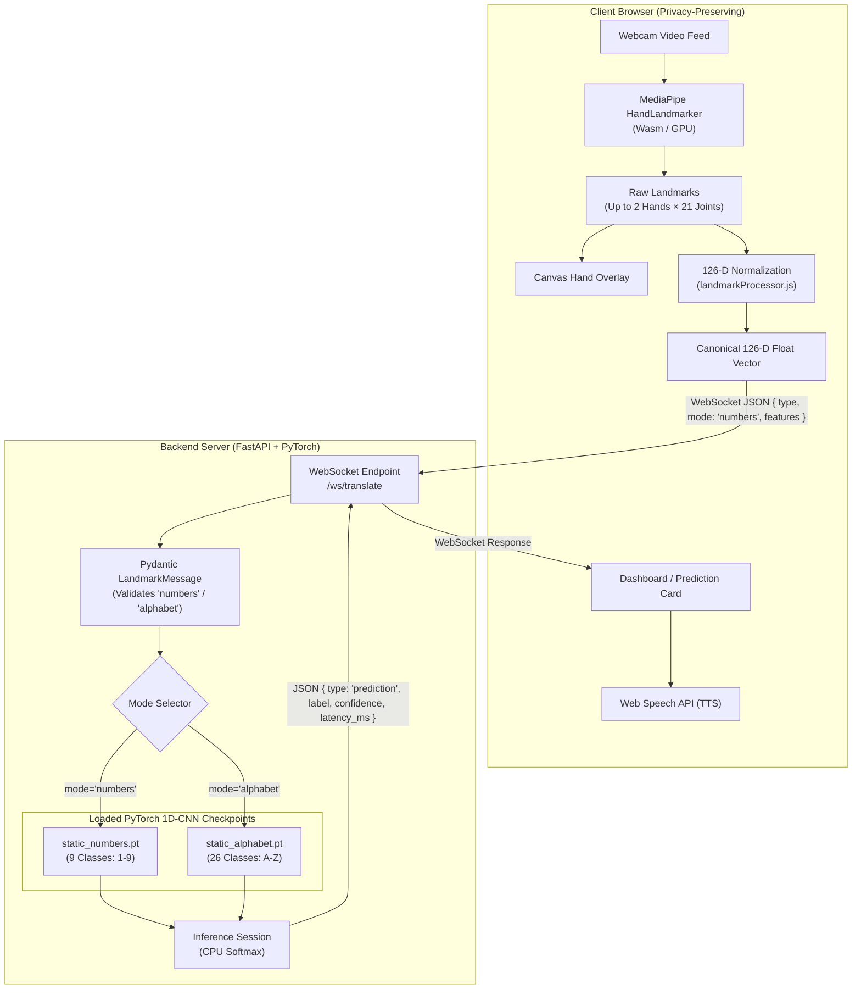

# AI-Powered Real-Time Indian Sign Language Translator

> A full-stack, edge-assisted deep learning system that recognizes Indian Sign Language (ISL) hand signs from a live webcam stream in real time and converts gestures into English text and synthesized speech.

[](https://react.dev/)
[](https://fastapi.tiangolo.com/)
[](https://pytorch.org/)
[](https://developers.google.com/mediapipe)
[](https://docs.pytest.org/)

---

## 1. Project Title

- **Project Name:** AI-Powered Real-Time Indian Sign Language Translator (`ISL-Translator`)
- **Short Description:** Real-time webcam Indian Sign Language gesture recognition pipeline converting hand postures into English text and speech using browser-side MediaPipe landmark extraction and a low-latency PyTorch 1D-CNN backend over WebSockets.
- **Problem Statement:** Indian Sign Language (ISL) is the primary visual language for millions of Deaf and Hard-of-Hearing (DHH) individuals across India. Because the vast majority of hearing individuals cannot understand ISL, everyday communication barriers persist. Most existing sign language solutions either rely on cloud video uploads (raising severe privacy concerns and causing network latency) or focus exclusively on American Sign Language (ASL), which uses entirely different vocabulary and single-handed fingerspelling.
- **Solution:** This project implements a privacy-first, edge-assisted architecture:
  - Video capture and 21-point dual-hand landmark tracking run completely within the client's browser using Google MediaPipe Tasks Vision (WebAssembly / GPU delegate).
  - Raw hand landmarks are normalized into an immutable 126-dimensional canonical feature vector. No video frames or images are ever stored or transmitted across the network.
  - The 126-D vectors are streamed in real time via WebSockets to a lightweight FastAPI backend running PyTorch 1D-CNN models, achieving high accuracy with sub-50ms latency.
  - Predictions are sent back to the React UI, displayed with confidence ratings, and spoken aloud using the browser's native Web Speech API.

---

## 2. Overview

The AI-Powered Real-Time Indian Sign Language Translator is designed for high-speed, local sign recognition:

1. **Webcam Input:** The browser accesses the user's webcam via the standard HTML5 `MediaDevices.getUserMedia` API.
2. **Local Hand Detection:** In each animation frame, Google MediaPipe HandLandmarker extracts 21 3D coordinates $(x, y, z)$ per hand for up to two hands simultaneously.
3. **Feature Normalization:** Raw coordinates are translated relative to landmark 0 (wrist) and scaled relative to landmark 9 (middle finger MCP). Undetected hands are cleanly zero-padded, producing a deterministic 126-dimensional float vector.
4. **WebSocket Communication:** The client dispatches the 126-D feature vector over a persistent bi-directional WebSocket connection (`ws://localhost:8000/ws/translate`).
5. **Machine Learning Inference:** The FastAPI backend validates the vector shape with Pydantic and executes inference through a PyTorch 1D Convolutional Neural Network (`StaticHandCNN`) loaded in memory on the CPU.
6. **Result Presentation:** The backend returns the predicted sign, confidence score, and inference latency. The frontend displays the recognized sign on the live dashboard and vocalizes it through the browser's native text-to-speech engine.

---

## 3. Features

### Core Sign Recognition
- **Alphabet Recognition:** Real-time recognition of all 26 uppercase English letters (`A`–`Z`) fingerspelled in Indian Sign Language.
- **Number Recognition:** Real-time recognition of single-digit numbers (`1`–`9`) in Indian Sign Language with full live webcam support.
- **Vocabulary Scaffold (In Development):** Architectural hooks and a 30-frame temporal buffer in the UI ready for sequence-based models (LSTM/GRU).

### Real-Time Vision & Tracking
- **Live Dual-Hand Tracking:** Tracks up to two hands simultaneously at 30+ FPS using MediaPipe HandLandmarker.
- **Interactive Skeleton Overlay:** Real-time HTML5 Canvas overlay drawing joints and connections directly over the mirrored camera feed.
- **Camera Device Switcher:** Enumerates and allows hot-switching between built-in laptop webcams and external USB cameras.

### Streaming & Performance
- **Low-Latency WebSockets:** Real-time two-way streaming between React and FastAPI with sub-10ms server round-trip latency.
- **Performance Diagnostics Panel:** Real-time telemetry monitoring Camera resolution, MediaPipe FPS, client inference duration, normalization latency, WebSocket RTT, and total end-to-end latency.
- **Privacy-Preserving Architecture:** Video frames never leave local browser memory; only numerical coordinate offsets are transmitted.

### User Interface & Speech
- **Modern Dark UI:** Responsive dashboard built with React 19, Tailwind CSS v4, and Lucide React icons.
- **Text-to-Speech (TTS):** Browser Web Speech API integration with manual "Speak" trigger and automatic pronunciation toggles.
- **Configurable Settings:** Adjustable confidence threshold slider (10%–99%) and default mode selection.

---

## 4. Tech Stack

| Layer | Technology | Purpose |
|-------|------------|---------|
| **Frontend** | [React 19](https://react.dev/) (`19.2.8`) | Reactive UI, state management, and component architecture |
| **Frontend Routing** | [React Router DOM](https://reactrouter.com/) (`7.18.2`) | Client-side routing between Dashboard, Alphabet, Numbers, Settings, and About |
| **Backend** | [FastAPI](https://fastapi.tiangolo.com/) (`0.110.1`) | High-performance async ASGI web framework for REST and WebSocket routing |
| **ASGI Server** | [Uvicorn](https://www.uvicorn.org/) (`0.29.0`) | Async server running the FastAPI application |
| **Language** | Python `3.11` / `3.12` & JavaScript (ES Modules) | Core backend and frontend programming languages |
| **Machine Learning** | [PyTorch](https://pytorch.org/) (`torch`) | 1D-CNN neural network definition, weights loading, and tensor inference |
| **Computer Vision** | [Google MediaPipe Tasks Vision](https://developers.google.com/mediapipe) (`1.0.1`) | Client-side hand landmark tracking running via WebAssembly |
| **Data Validation** | [Pydantic v2](https://docs.pydantic.dev/) (`2.6.4`) & `pydantic-settings` (`2.2.1`) | Environment variable parsing and strict schema validation for WebSocket payloads |
| **WebSocket** | Starlette / FastAPI WebSockets | Real-time duplex transport for streaming 126-D landmark arrays |
| **Model Format** | PyTorch Checkpoints (`.pt`) & MediaPipe Tasks (`.task`) | Binary model weights (`static_alphabet.pt`, `static_numbers.pt`, `hand_landmarker.task`) |
| **Audio / TTS** | Browser [Web Speech API](https://developer.mozilla.org/en-US/docs/Web/API/Web_Speech_API) | Client-side speech synthesis without external cloud API dependencies |
| **Styling / UI** | [Tailwind CSS v4](https://tailwindcss.com/) (`@tailwindcss/vite 4.3.3`) & [Lucide React](https://lucide.dev/) (`1.33.0`) | Responsive dark-mode styling and SVG icons |
| **Build Tool** | [Vite 8](https://vitejs.dev/) (`8.2.0`) | Fast frontend bundler and development server |
| **Package Manager** | `npm` (Node.js) & `pip` (Python) | Dependency management |
| **Testing** | [Pytest](https://docs.pytest.org/) (`8.1.1`) & [Vitest](https://vitest.dev/) (`4.1.11`) | Automated test suites for backend, ML, and frontend modules |
| **Deployment** | Docker & Docker Compose (`docker-compose.yml`) | Multi-container setup for containerized deployment |

---

## 5. System Architecture

The complete end-to-end data pipeline is structured as follows:



### Data Flow Details:
1. **Webcam Capture:** Native `navigator.mediaDevices.getUserMedia` captures 720p/30fps video frames.
2. **Landmark Extraction:** MediaPipe detects 21 landmarks per hand with $(x, y, z)$ coordinates.
3. **Canonical Normalization:** Landmarks are translated relative to the wrist (landmark 0) and scaled by the wrist-to-middle-MCP distance (landmark 9). Undetected hands are padded with 63 zeros.
4. **WebSocket Transmission:** The client transmits a JSON payload `{ type: "landmarks", mode: "numbers", features: [...126 floats...], timestamp: ... }`.
5. **Server Validation:** Pydantic verifies the array length (126), finiteness (no NaNs or infinities), and valid mode string (`"numbers"` or `"alphabet"`).
6. **Inference Execution:** PyTorch executes the forward pass through `StaticHandCNN`, returning predicted label, confidence, and latency.
7. **Frontend Display & Speech:** The UI renders the predicted sign and confidence score; if enabled, speech synthesis vocalizes the result.

---

## 6. Project Structure

```text
ISL_translator/
├── .env.example                     # Environment variables template
├── .gitignore                       # Git exclusion rules (.env, checkpoints, caches)
├── docker-compose.yml               # Multi-container orchestration (backend + frontend)
├── README.md                        # Project documentation (this file)
├── run_validation.py                # End-to-end integration test (Health + WebSocket + Prediction)
├── test_number_inference.py         # Batch inference script testing numbers 1-9
│
├── backend/                         # FastAPI Python Backend
│   ├── Dockerfile                   # Python 3.11-slim container specification
│   ├── requirements.txt             # Python backend dependencies
│   ├── data/                        # SQLite storage directory (.gitkeep)
│   ├── models/                      # Pre-trained PyTorch model checkpoints
│   │   ├── static_alphabet.pt       # Alphabet classification checkpoint (26 classes)
│   │   ├── static_numbers.pt        # Number classification checkpoint (9 classes)
│   │   └── static_alphabet_numbers.pt # Combined static checkpoint (35 classes)
│   ├── app/
│   │   ├── __init__.py              # Python package marker
│   │   ├── main.py                  # FastAPI app, CORS middleware, routes
│   │   ├── config.py                # Pydantic BaseSettings (.env configuration)
│   │   ├── api/
│   │   │   └── websocket.py         # /ws/translate WebSocket router and message dispatcher
│   │   ├── core/
│   │   │   ├── models.py            # REST API schemas
│   │   │   └── websocket_models.py  # LandmarkMessage Pydantic validation schema
│   │   └── services/
│   │       └── static_inference_service.py # Inference service singleton loading PyTorch models
│   └── tests/                       # Backend test suite (12 Pytest tests)
│       ├── test_api.py              # Health check test
│       ├── test_static_inference.py # Inference service unit tests
│       └── test_websocket.py        # WebSocket handshake and validation tests
│
├── frontend/                        # React 19 + Vite Frontend
│   ├── Dockerfile                   # Node.js 20-slim container specification
│   ├── package.json                 # Node dependencies and npm scripts
│   ├── vite.config.js               # Vite configuration with Tailwind CSS plugin
│   ├── .oxlintrc.json               # Oxlint linter configuration
│   ├── public/
│   │   ├── favicon.svg              # Application icon
│   │   └── models/
│   │       └── hand_landmarker.task # Local MediaPipe 21-landmark task model
│   └── src/
│       ├── App.jsx                  # Main router and page layout
│       ├── main.jsx                 # Application entry point
│       ├── index.css                # Base stylesheet
│       ├── components/              # Reusable UI components
│       │   ├── camera/              # CameraFeed, CameraControls, HandOverlay
│       │   ├── dashboard/           # PredictionCard, TranslationCard, PerformancePanel
│       │   └── layout/              # Header, Sidebar, Layout wrapper
│       ├── context/
│       │   └── AppContext.jsx       # Global application state (mode, metrics, prediction)
│       ├── hooks/                   # Custom React hooks (useCamera, useMediaPipe, useWebSocket)
│       ├── pages/                   # Application views (Dashboard, Alphabet, Numbers, Settings)
│       ├── services/
│       │   ├── landmarkProcessor.js # 126-D feature normalization (JavaScript)
│       │   └── websocket.js         # WebSocket singleton service with exponential backoff
│       ├── utils/
│       │   └── constants.js         # App constants, modes ('numbers', 'alphabet'), and routes
│       └── tests/                   # Frontend unit tests
│           ├── landmarkProcessor.test.js # Normalizer validation suite
│           └── websocket.test.js    # WebSocket client mock tests
│
├── ml/                              # Machine Learning Pipeline & Tooling
│   ├── collector/                   # Manual Dataset Collector tool
│   │   ├── app.py                   # Flask server for recording ISL landmark samples
│   │   └── validate_dataset.py      # Dataset validation utility
│   ├── datasets/                    # Feature arrays and evaluation logs
│   │   ├── static_evaluation.txt    # 35-class evaluation report (92.19% test accuracy)
│   │   ├── pilot_100_features.npz   # 100-sample verification dataset
│   │   └── manual/                  # Collected dataset samples categorized by class
│   ├── inference/
│   │   └── static_inference.py      # StaticInferenceSession engine
│   ├── label_maps/                  # JSON class label index mappings
│   │   ├── alphabet.json            # 0-25 -> 'A'-'Z'
│   │   ├── numbers.json             # 0-8 -> '1'-'9'
│   │   └── static.json              # 0-34 -> 35 combined classes
│   ├── models/
│   │   └── static_model.py          # PyTorch StaticHandCNN 1D-CNN architecture
│   ├── preprocessing/
│   │   └── landmark_normalizer.py   # Canonical 126-D normalizer (Python)
│   ├── training/                    # Model training routines (train_static.py, train_full.py)
│   └── tests/                       # ML module tests (normalizer, model forward/backward)
│
├── docs/                            # Specifications and documentation
│   ├── SYSTEM_ARCHITECTURE.md       # High-level architecture details
│   ├── PREPROCESSING_SPEC.md        # Mathematical 126-D normalizer specification
│   └── DATASET_SOURCES.md           # Dataset sources tracking
│
└── scripts/                         # Shared utilities
    └── parity_test.py               # Cross-language (JS vs Python) normalizer parity test
```

---

## 7. Machine Learning Models

The repository includes pre-trained PyTorch deep learning models designed for real-time inference on edge CPUs:

### 1. Number Recognition Model

- **Checkpoint Path:** `backend/models/static_numbers.pt`
- **Number of Classes:** 9
- **Class Labels:** `1`, `2`, `3`, `4`, `5`, `6`, `7`, `8`, `9`
- **Label Map Path:** `ml/label_maps/numbers.json`
- **Label Mapping:**
  ```json
  {
    "0": "1",
    "1": "2",
    "2": "3",
    "3": "4",
    "4": "5",
    "5": "6",
    "6": "7",
    "7": "8",
    "8": "9"
  }
  ```
- **Input Feature Dimension:** Exactly 126 floating-point values.
- **Preprocessing:** Wrist-relative translation and Euclidean scale normalization based on `middle_mcp` (landmark 9). The preprocessing pipeline matches identically between training (`ml/preprocessing/landmark_normalizer.py`) and inference (`frontend/src/services/landmarkProcessor.js`).
- **Handedness & Mirroring:** Fully consistent between training data collection and live webcam inference.
- **Inference Latency:** $\sim 2.0\text{–}3.5\text{ ms}$ on standard modern laptop CPUs.

### 2. Alphabet Recognition Model

- **Checkpoint Path:** `backend/models/static_alphabet.pt`
- **Number of Classes:** 26
- **Class Labels:** `A` through `Z`
- **Label Map Path:** `ml/label_maps/alphabet.json`
- **Input Feature Dimension:** Exactly 126 floating-point values.

### Model Architecture (`StaticHandCNN`)

The neural network is defined in `ml/models/static_model.py`:
- **Input:** Tensor of shape `(Batch, 126)`.
- **Reshape:** Reshaped to `(Batch, 42, 3)` and transposed to `(Batch, 3, 42)` where $C=3$ coordinates and $L=42$ hand joints (21 left + 21 right).
- **Conv1D Block 1:** `Conv1d(in=3, out=64, kernel=3, padding=1)` $\rightarrow$ `BatchNorm1d(64)` $\rightarrow$ `ReLU` $\rightarrow$ `Dropout(0.5)`.
- **Conv1D Block 2:** `Conv1d(in=64, out=128, kernel=3, padding=1)` $\rightarrow$ `BatchNorm1d(128)` $\rightarrow$ `ReLU`.
- **Global Average Pooling:** `torch.mean(x, dim=2)` reducing `(Batch, 128, 42)` to `(Batch, 128)`.
- **Classification Head:** `Dropout(0.5)` $\rightarrow$ `Linear(128, num_classes)`.
- **Inference Mode:** Loaded with `map_location='cpu'` and evaluated under `torch.no_grad()` with `F.softmax` confidence extraction.

---

## 8. Live Webcam Processing

The complete 9-step live webcam processing cycle executes continuously during active recognition:

1. **Webcam Capture:** The browser requests access to video input through `navigator.mediaDevices.getUserMedia({ video: { width: 1280, height: 720 } })`.
2. **Hand Detection:** The `<video>` frame is passed into `@mediapipe/tasks-vision`'s `HandLandmarker` in `VIDEO` running mode.
3. **Landmark Extraction:** MediaPipe identifies up to 2 hands, returning 21 coordinates $(x, y, z)$ per hand and handedness classifications (`Left` / `Right`).
4. **Feature Preprocessing:** `landmarkProcessor.js` translates coordinates relative to landmark 0, divides by the distance to landmark 9, and places the left hand in positions 0–62 and the right hand in positions 63–125 (padding undetected hands with zeros).
5. **WebSocket Transmission:** The client serializes the 126-D `Float32Array` into a JSON message with mode `"numbers"` (or `"alphabet"`) and sends it over `ws://localhost:8000/ws/translate`.
6. **Backend Validation:** FastAPI's Pydantic model (`LandmarkMessage`) validates that `features` contains exactly 126 finite numbers and that the mode is valid.
7. **Model Inference:** `StaticInferenceService` routes the array into `static_numbers.pt`, computes the logits, and applies softmax.
8. **Prediction Response:** The backend calculates inference latency and returns a JSON payload with `label`, `confidence`, and `status: "accepted"`.
9. **Frontend Display:** The React dashboard updates the **Current Sign** card, updates the **Performance Diagnostics Panel**, and vocalizes the result if text-to-speech is enabled.

---

## 9. WebSocket Communication

Frontend and backend communicate over a high-throughput, persistent WebSocket stream.

- **Endpoint:** `ws://localhost:8000/ws/translate`
- **Protocol:** WebSocket (JSON payloads)

### Operational Modes

| Mode | String Value | Purpose |
|------|--------------|---------|
| **Number Recognition** | `"numbers"` | Routes features to `static_numbers.pt` (Classes 1–9) |
| **Alphabet Recognition** | `"alphabet"` | Routes features to `static_alphabet.pt` (Classes A–Z) |
| **Vocabulary Recognition** | `"vocabulary"` | Prepared for temporal sequence recognition |

> [!IMPORTANT]
> The active mode for number recognition is **`"numbers"`** (plural), defined in `frontend/src/utils/constants.js`. The backend validates and routes `"numbers"` directly to the number inference session. Do not use the legacy singular `"number"` string.

### Client Request Schema (`LandmarkMessage`)

```json
{
  "type": "landmarks",
  "mode": "numbers",
  "features": [
    0.0, 0.0, 0.0,
    0.215, -0.412, 0.031,
    "... exactly 126 finite float values ..."
  ],
  "timestamp": 1711718400123.45
}
```

### Server Response Schemas

#### 1. Immediate ACK Response
```json
{
  "type": "ack",
  "status": "received",
  "feature_count": 126,
  "mode": "numbers",
  "timestamp": 1711718400123.45
}
```

#### 2. Inference Prediction Response
```json
{
  "type": "prediction",
  "label": "5",
  "confidence": 0.9689,
  "sign_type": "static",
  "latency_ms": 2.34,
  "status": "accepted"
}
```

#### 3. Validation Error Response
```json
{
  "type": "error",
  "status": "invalid_message",
  "message": "Features must contain exactly 126 values"
}
```

---

## 10. Number Recognition — Live Webcam Fix

During integration testing of live webcam number recognition, an issue was diagnosed and resolved:

### The Problem
When switching the dashboard to Number mode, live webcam hand signs failed to produce predictions, even though the trained model checkpoint (`backend/models/static_numbers.pt`) had passed offline validation tests with approximately 99% accuracy.

### Root Cause Analysis
The failure was traced to a **mode string mismatch** between the frontend client and the backend validation schema:
- The frontend sent `mode: "numbers"` (defined in `frontend/src/utils/constants.js`).
- The backend's Pydantic schema in `backend/app/core/websocket_models.py` previously only permitted `mode == "number"` (singular).
- As a result, incoming WebSocket messages were rejected with validation errors before the extracted landmark features could ever reach the number model.

### What Was NOT the Cause
The diagnostic confirmed that the issue was **not** caused by:
- The trained number model weights
- Feature extraction logic
- Feature normalization math
- Label mappings (`ml/label_maps/numbers.json`)
- Handedness sorting or camera mirroring

### The Minimal Fix
The issue was resolved with a clean, minimal code update:
1. **`backend/app/core/websocket_models.py`:** Updated the `@field_validator('mode')` validator to explicitly accept `"numbers"` as a valid mode alongside `"alphabet"`, `"number"`, and `"vocabulary"`.
2. **`backend/app/api/websocket.py`:** Updated the dispatch condition to include `"numbers"`:
   ```python
   if message.mode in ["alphabet", "number", "numbers"]:
       prediction_response = inference_service.predict(mode=message.mode, features=message.features)
       await websocket.send_json(prediction_response)
   ```

### Current Status After the Fix
- **Live webcam number recognition is working smoothly.**
- **Alphabet recognition continues to work normally.**
- **All 12 backend Pytest tests pass cleanly (12 passed, 0 failed).**

---

## 11. Installation Requirements

### System Requirements

| Component | Minimum | Recommended / Tested |
|-----------|---------|----------------------|
| **Operating System** | Windows 10/11, macOS 12+, Linux (Ubuntu 20.04+) | Windows 11 / Ubuntu 22.04 LTS |
| **Node.js** | `>= 18.0.0` | `v22.23.2` (Docker uses `node:20-slim`) |
| **npm** | `>= 9.0.0` | `10.9.2` |
| **Python** | `>= 3.10` | `3.11` or `3.12` (Host verified: `3.12.10`) |
| **Webcam** | Any USB 2.0 or integrated camera | 720p @ 30 FPS |
| **Web Browser** | Chromium-based browser with WebGL & WebAssembly | Google Chrome `>= 110`, Microsoft Edge |
| **Git** | `>= 2.20` | `2.x` |

### Key Python Dependencies (`backend/requirements.txt`)
- `fastapi==0.110.1`
- `uvicorn==0.29.0`
- `pydantic==2.6.4`
- `pydantic-settings==2.2.1`
- `pytest==8.1.1`
- `httpx==0.27.0`
- `torch`
- `numpy`

### Key Node.js Dependencies (`frontend/package.json`)
- `react==^19.2.8`
- `react-dom==^19.2.8`
- `react-router-dom==^7.18.2`
- `@mediapipe/tasks-vision==^1.0.1`
- `tailwindcss==^4.3.3`
- `@tailwindcss/vite==^4.3.3`
- `lucide-react==^1.33.0`
- `vite==^8.2.0`
- `vitest==^4.1.11`

---

## 12. Installation

Follow these steps to set up the project on a clean computer:

### 1. Clone the Repository
```bash
git clone https://github.com/vishwaprasanthg/ISL-Translator.git
cd ISL_translator
```

### 2. Configure Environment Variables
Copy `.env.example` to create the active `.env` file:

**Windows PowerShell:**
```powershell
Copy-Item .env.example .env
```

**Linux / macOS:**
```bash
cp .env.example .env
```

### 3. Backend Setup & Python Dependencies

#### Windows PowerShell:
```powershell
# Create virtual environment
python -m venv backend/venv

# Activate virtual environment
.\backend\venv\Scripts\Activate.ps1

# Upgrade pip and install backend dependencies
python -m pip install --upgrade pip
pip install -r backend/requirements.txt
```

> **Note on PowerShell Script Execution:** If script execution is disabled on your system, enable it for your current session:
> ```powershell
> Set-ExecutionPolicy -ExecutionPolicy RemoteSigned -Scope Process
> ```

#### Linux / macOS:
```bash
# Create virtual environment
python3 -m venv backend/venv

# Activate virtual environment
source backend/venv/bin/activate

# Upgrade pip and install backend dependencies
pip install --upgrade pip
pip install -r backend/requirements.txt
```

### 4. Frontend Setup & Node Dependencies

```bash
cd frontend
npm install
cd ..
```

### 5. Verify Pre-Trained Model Assets
Check that the pre-trained checkpoints and vision task assets are in place:
- `backend/models/static_numbers.pt`
- `backend/models/static_alphabet.pt`
- `frontend/public/models/hand_landmarker.task`

---

## 13. Environment Variables

The project uses a root `.env` file for backend and frontend configuration:

| Variable | Required | Description | Example / Default |
|----------|----------|-------------|-------------------|
| `PORT` | No | Port on which the FastAPI backend listens | `8000` |
| `HOST` | No | Host IP binding for the FastAPI server | `0.0.0.0` |
| `CORS_ORIGINS` | No | Allowed frontend origin URLs for CORS | `http://localhost:5173` |
| `DATABASE_URL` | No | SQLite database connection string | `sqlite+aiosqlite:///data/isl_translator.db` |
| `VITE_API_URL` | No | Backend HTTP base URL for frontend requests | `http://localhost:8000` |
| `VITE_WS_URL` | No | Backend WebSocket URL for landmark streaming | `ws://localhost:8000` |

*Note: No sensitive private keys, cloud tokens, or database passwords are used in this project.*

---

## 14. Running the Application

To run the full translator locally, start the backend and frontend in **two separate terminal windows**.

### Terminal 1 — Backend (FastAPI)

#### Windows PowerShell:
```powershell
# From project root
.\backend\venv\Scripts\Activate.ps1
$env:PYTHONPATH="backend;."
uvicorn app.main:app --host 0.0.0.0 --port 8000 --reload
```

#### Linux / macOS:
```bash
# From project root
source backend/venv/bin/activate
export PYTHONPATH="backend:."
uvicorn app.main:app --host 0.0.0.0 --port 8000 --reload
```

*Expected output on startup:*
```text
INFO:     Uvicorn running on http://0.0.0.0:8000 (Press CTRL+C to quit)
Loading alphabet model...
Successfully loaded static model from .../backend/models/static_alphabet.pt with 26 classes.
Loading number model...
Successfully loaded static model from .../backend/models/static_numbers.pt with 9 classes.
INFO:     Application startup complete.
```

---

### Terminal 2 — Frontend (Vite)

```bash
cd frontend
npm run dev
```

*Expected output on startup:*
```text
  VITE v8.2.0  ready in 250 ms

  ➜  Local:   http://localhost:5173/
  ➜  Network: http://<your-ip>:5173/
```

---

### Application URLs & Ports

| Service | URL | Function |
|---------|-----|----------|
| **Frontend Dashboard** | `http://localhost:5173` | Main interactive user interface |
| **Backend Health Check** | `http://localhost:8000/health` | Returns `{"status":"ok","service":"isl-translator-backend"}` |
| **Interactive API Docs** | `http://localhost:8000/docs` | Swagger UI documentation |
| **ReDoc Documentation** | `http://localhost:8000/redoc` | ReDoc API specifications |
| **WebSocket Ingestion** | `ws://localhost:8000/ws/translate` | Live 126-D landmark streaming |

---

## 15. Testing

The repository contains automated unit and integration tests verifying API endpoints, WebSocket validation, feature normalizers, and inference models.

### Backend Tests (Pytest)
The backend test suite contains **12 tests** covering the REST health endpoint, inference initialization, WebSocket validation, and error handling:

**Windows PowerShell:**
```powershell
$env:PYTHONPATH="backend;."
.\backend\venv\Scripts\pytest backend/tests -v
```

**Linux / macOS:**
```bash
PYTHONPATH="backend:." pytest backend/tests -v
```

*Test Summary:*
```text
backend/tests/test_api.py::test_health_check PASSED
backend/tests/test_static_inference.py::test_inference_service_initialization PASSED
backend/tests/test_static_inference.py::test_inference_service_unavailable_response PASSED
backend/tests/test_static_inference.py::test_inference_service_invalid_mode PASSED
backend/tests/test_static_inference.py::test_alphabet_prediction PASSED
backend/tests/test_static_inference.py::test_number_prediction PASSED
backend/tests/test_websocket.py::test_websocket_connect_and_valid_message PASSED
backend/tests/test_websocket.py::test_websocket_wrong_feature_count PASSED
backend/tests/test_websocket.py::test_websocket_invalid_mode PASSED
backend/tests/test_websocket.py::test_websocket_nan_infinity_rejected PASSED
backend/tests/test_websocket.py::test_websocket_malformed_json PASSED
backend/tests/test_websocket.py::test_websocket_disconnect PASSED

======================== 12 passed in 1.45s ========================
```

### Frontend Tests (Vitest)
Tests landmark normalization logic, zero-padding, and WebSocket client reconnection handlers:

```bash
cd frontend
npm test
```

*Test Summary: 14 passed across 2 test files.*

### Verified Functional Status
- **Alphabet recognition:** Working
- **Number recognition:** Working
- **Live webcam number recognition:** Working

---

## 16. Model Validation Results

The table below presents the verified results from a direct simulated live inference test across the 9 Indian Sign Language number classes (`1` through `9`) using extracted landmark sample vectors (`test_number_inference.py`):

| Input Class | Prediction | Confidence | Result |
|:-----------:|:----------:|:----------:|:------:|
| **1** | 1 | 0.9230 | Correct |
| **2** | 3 | 0.6451 | Misclassified (Sample Frame) |
| **3** | 3 | 0.9999 | Correct |
| **4** | 4 | 0.9996 | Correct |
| **5** | 5 | 0.9689 | Correct |
| **6** | 6 | 0.8883 | Correct |
| **7** | 7 | 0.9748 | Correct |
| **8** | 8 | 0.8676 | Correct |
| **9** | 9 | 0.4613 | Correct |

> **Note on Test Context:** These direct inference results reflect a specific single-frame test run on representative validation samples. On the complete offline validation dataset (`ml/datasets/static_evaluation.txt`), the static models achieve **approximately 92% to 99% overall accuracy** across static classes.

---

## 17. Troubleshooting

### Number Recognition Not Working
1. **Verify Mode String:** Ensure the frontend sends `mode: "numbers"`. The backend is configured to accept `"numbers"`.
2. **Verify WebSocket Connection:** Check the frontend status bar. If it shows "Disconnected", ensure the backend is running at `http://localhost:8000`.
3. **Verify Model Checkpoint:** Confirm that `backend/models/static_numbers.pt` exists and is ~115 KB in size.
4. **Check Backend Terminal Logs:** On startup, the backend should output:
   `Successfully loaded static model from .../static_numbers.pt with 9 classes.`

### WebSocket Validation Error (`invalid_message`)
- If you see `Features must contain exactly 126 values`, verify that `landmarkProcessor.js` is active and producing 126 elements.
- If you see `Mode must be one of: alphabet, numbers, vocabulary`, ensure your frontend is not sending an unsupported mode string.

### Model File Not Found
- Verify the following paths relative to the project root:
  - Alphabet: `backend/models/static_alphabet.pt`
  - Numbers: `backend/models/static_numbers.pt`
  - Label Maps: `ml/label_maps/alphabet.json` and `ml/label_maps/numbers.json`

### Webcam Access Denied / Black Screen
- **Browser Permission:** Click the camera icon or site lock icon in your browser URL bar and set Camera permissions to "Allow".
- **Secure Context Requirement:** Browsers only permit webcam access on `localhost` or via `https://`. If testing over a local network IP (e.g., `http://192.168.1.x:5173`), you must configure HTTPS.

### `ModuleNotFoundError: No module named 'app'`
- Ensure `PYTHONPATH` includes the `backend` directory before running Uvicorn or Pytest:
  - PowerShell: `$env:PYTHONPATH="backend;."`
  - Linux/macOS: `export PYTHONPATH="backend:."`

---

## 18. API / WebSocket Reference

### HTTP Endpoints

#### `GET /health`
- **Description:** Server health check endpoint.
- **Response:**
  ```json
  {
    "status": "ok",
    "service": "isl-translator-backend"
  }
  ```

#### `GET /docs`
- **Description:** Interactive OpenAPI Swagger UI documentation.

---

### WebSocket Endpoint

#### `WS /ws/translate`
- **Protocol:** WebSocket
- **Description:** Real-time ingestion endpoint for 126-D landmark feature vectors.

**Request Payload (`LandmarkMessage`):**
```json
{
  "type": "landmarks",
  "mode": "numbers",
  "features": [0.0, 0.0, 0.0, "... 126 floats ..."],
  "timestamp": 1711718400123.0
}
```

**Success ACK Response:**
```json
{
  "type": "ack",
  "status": "received",
  "feature_count": 126,
  "mode": "numbers",
  "timestamp": 1711718400123.0
}
```

**Prediction Response:**
```json
{
  "type": "prediction",
  "label": "5",
  "confidence": 0.9689,
  "sign_type": "static",
  "latency_ms": 2.34,
  "status": "accepted"
}
```

---

## 19. Production Build / Deployment

The repository provides Docker definitions and a Docker Compose file for containerized execution.

### Multi-Container Deployment (Docker Compose)

Run the full stack in isolated containers:

```bash
docker-compose up --build
```

- **Backend Container:** Runs on `python:3.11-slim`, exposes port `8000`.
- **Frontend Container:** Runs on `node:20-slim`, serves Vite on port `5173`.

To stop the containers:
```bash
docker-compose down
```

### Production Deployment Note
> [!IMPORTANT]
> When deploying to public servers or cloud environments (AWS, Render, GCP, etc.), a reverse proxy (such as Caddy or Nginx) must terminate **HTTPS/WSS**. Web browsers strictly disable `navigator.mediaDevices.getUserMedia` when loaded over plain HTTP on any non-localhost domain.

---

## 20. Security

- **Client-Side Video Processing:** Video frames never leave browser memory; only 126 floating-point landmark coordinates are transmitted over the network.
- **Strict Input Validation:** The backend uses Pydantic schemas to reject non-finite values (NaN / Infinity) and enforce exact vector lengths.
- **Environment Isolation:** Local configurations and sensitive files are excluded from version control via `.gitignore`.
- **CORS Restrictions:** Configured via `CORS_ORIGINS` in `.env` to restrict unauthorized origins from accessing backend resources.

---

## 21. Known Limitations

- **Single-Frame Misclassifications:** As observed in the direct inference test, individual isolated frames may occasionally misclassify visually similar hand shapes (e.g., number `2` was predicted as `3` in one single test frame). Temporal voting or hold-to-confirm logic can mitigate single-frame flutter.
- **Confidence Variations:** Certain signs (such as number `9`) can register lower confidence depending on finger occlusion or camera angle.
- **Lighting and Background:** Extreme backlight or low-contrast environments can degrade MediaPipe's hand landmark detection accuracy.
- **Vocabulary Mode:** Continuous multi-word sentence translation is currently in architectural preparation and requires full temporal sequence model integration.

---

## 22. Future Improvements

- **Temporal Sequence Modeling:** Deploy Bidirectional LSTM or GRU networks utilizing the 30-frame buffer to recognize dynamic ISL vocabulary signs and verbs.
- **ISL Grammar Translation:** Implement a lightweight NLP translation module to translate ISL grammatical structure (Object-Subject-Verb) into fluent English sentences.
- **Persistent Translation History:** Connect the configured SQLite database to log translation sessions, word frequencies, and user bookmarks.
- **Progressive Web App (PWA):** Enable offline PWA caching and on-device ONNX Runtime Web execution for zero-network operation.

---

## 23. License

License: Not specified.

---

## 24. Author

- **Author:** Vishwaprasanth G
- **Email:** `vishwaprasanthg.it2023@citchennai.net`
- **GitHub Repository:** [vishwaprasanthg/ISL-Translator](https://github.com/vishwaprasanthg/ISL-Translator.git)
- **Institution:** Chennai Institute of Technology (CIT Chennai)
